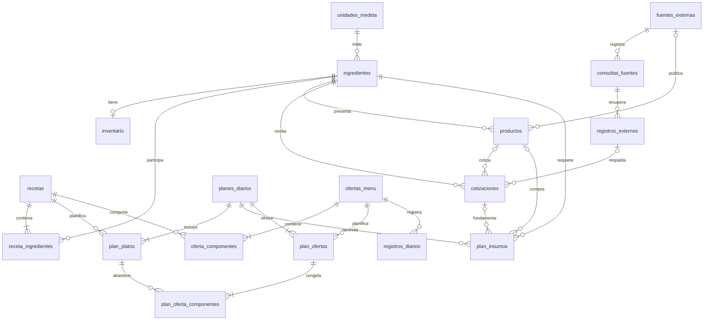

# Diseño de base de datos de Menú Rentable AQP

## Propósito y alcance

Modelo relacional propuesto para un negocio de comida, con importes en soles y fechas de operación de Arequipa. Integra recetas, inventario, fuentes externas, planificación y resultados. El esquema descrito se implementó en database/migrations/001_relacional_menu.sql. El catálogo y los menús completos ya se consultan en PostgreSQL y el nuevo planificador guarda cabecera y detalles relacionales. Las pantallas legadas conservan datos en el navegador y daily_plans sigue disponible para compatibilidad. Las tablas de fuentes y ventas existen, pero sus flujos siguen pendientes.

El diseño inicial no incluye autenticación ni múltiples negocios. Registrar una organización como fuente no equivale a tener un conector automático implementado. Los datos de ONG pueden ser informativos y no necesariamente contienen precios.

## Convenciones

PK significa clave primaria; FK, clave foránea; UQ, unicidad. Las claves serán bigint identity, salvo códigos de unidad. Cantidades: numeric(14,4); precios unitarios: numeric(14,4); totales monetarios: numeric(14,2). Se utilizan Decimal en Python y reglas de redondeo explícitas al presentar totales. Instantes de consulta: timestamptz; fecha comercial: date. Moneda inicial PEN. Los nombres descriptivos y capturas históricas se conservan como texto Unicode.

## Diccionario de entidades y campos

### unidades_medida

- codigo varchar(8), PK: kg, L o unidad.
- nombre varchar(40), obligatorio.
- dimension varchar(12), obligatorio: masa, volumen o conteo.

Se normalizan gramos a kg y mililitros a L antes de almacenar cantidades. No se convierten kg a L sin una conversión específica verificada.

### ingredientes

- id bigint, PK.
- codigo_legacy varchar(100), UQ, opcional: identificador actual de React para migración.
- nombre varchar(150), obligatorio; búsqueda normalizada para evitar duplicados accidentales.
- unidad_codigo varchar(8), FK unidades_medida, obligatorio.
- activo boolean, obligatorio, predeterminado true.

### recetas

- id bigint, PK.
- codigo_legacy varchar(100), UQ, opcional.
- nombre varchar(150), obligatorio.
- categoria varchar(20), obligatorio: caldo, entrada, segundo o refresco.
- estilo varchar(40), opcional: menú diario o picantería, por ejemplo.
- rendimiento integer, obligatorio y mayor que cero: porciones obtenidas con la receta base.
- Las recetas no determinan el ingreso del menú. Un precio de venta individual solo se incorporará si se confirma venta a la carta.
- preparacion text, opcional.
- activo boolean, obligatorio, predeterminado true.

### receta_ingredientes

- receta_id bigint, PK compuesta y FK recetas.
- ingrediente_id bigint, PK compuesta y FK ingredientes.
- cantidad numeric(14,4), obligatoria y mayor que cero, en la unidad base del ingrediente.

Resuelve la relación muchos a muchos entre recetas e ingredientes. No se repite un ingrediente dentro de la misma receta. Cambiar la unidad base requiere convertir referencias existentes; no es una edición libre.

### inventario

- ingrediente_id bigint, PK y FK ingredientes.
- existencia numeric(14,4), obligatoria y no negativa.
- costo_unitario numeric(14,4), obligatorio y no negativo, por unidad base.
- actualizado_en timestamptz, obligatorio.

Una existencia por ingrediente para el negocio. En este alcance se actualiza manualmente; guardar un plan no descuenta existencias. El control por lotes, vencimientos y movimientos automáticos queda para una ampliación.

### fuentes_externas

- id bigint, PK.
- nombre varchar(150), obligatorio.
- tipo varchar(12), obligatorio: estado, privada u ong.
- url_base text, obligatoria.
- conector varchar(80), UQ, opcional: identificador del adaptador Python permitido.
- activo boolean, obligatorio.

Los conectores consultan direcciones permitidas desde el backend; la URL registrada no habilita consultas arbitrarias proporcionadas por el usuario.

### consultas_fuentes

- id bigint, PK.
- fuente_id bigint, FK fuentes_externas, obligatorio.
- iniciado_en timestamptz, obligatorio.
- terminado_en timestamptz, opcional mientras se ejecuta.
- estado varchar(15), obligatorio: ejecutando, correcto, parcial o error.
- registros_obtenidos integer, obligatorio, no negativo.
- mensaje_error text, opcional, sin credenciales ni información sensible.

Registra también intentos fallidos. El error no elimina los últimos datos válidos. No se confunde la fecha de recuperación con la fecha de publicación de la fuente.

### registros_externos

- id bigint, PK.
- consulta_id bigint, FK consultas_fuentes, obligatorio.
- clave_externa text, opcional.
- tipo_dato varchar(30), obligatorio: precio, producto, programa o publicación.
- titulo text, obligatorio.
- url_origen text, obligatoria.
- publicado_en date, opcional si la fuente no informa fecha.
- ubicacion text, opcional: mercado, ciudad o cobertura declarada.
- contenido jsonb, obligatorio: datos estructurados extraídos y metadatos pertinentes.
- hash_contenido char(64), obligatorio: huella para rastrear cambios.

UQ propuesta: consulta_id, hash_contenido. JSONB se reserva para contenido externo heterogéneo; las entidades de negocio permanecen relacionales. Se almacenan datos pertinentes, sin replicar innecesariamente documentos completos.

### productos

- id bigint, PK.
- ingrediente_id bigint, FK ingredientes, obligatorio.
- fuente_id bigint, FK fuentes_externas, opcional para productos ingresados manualmente.
- codigo_externo text, opcional.
- nombre varchar(200), obligatorio.
- marca varchar(100), opcional.
- contenido_base numeric(14,4), obligatorio y mayor que cero, expresado en la unidad del ingrediente.
- url_producto text, opcional.
- activo boolean, obligatorio.

Una presentación equivale a un producto distinto. La asociación entre el producto externo y el ingrediente debe validarse; no se asigna solo por similitud del nombre.

### cotizaciones

- id bigint, PK.
- ingrediente_id bigint, FK ingredientes, obligatorio.
- producto_id bigint, FK productos, opcional cuando solo se informa precio referencial de un ingrediente.
- registro_externo_id bigint, FK registros_externos, opcional para carga manual.
- origen varchar(12), obligatorio: manual o automatico.
- tipo_precio varchar(15), obligatorio: referencial o compra.
- proveedor text, obligatorio.
- ubicacion text, obligatoria: evita tratar precios de Lima como precios de Arequipa.
- fecha_precio date, opcional si no se publica; mostrar explícitamente que es desconocida.
- recuperado_en timestamptz, obligatorio.
- precio numeric(14,4), obligatorio y no negativo.
- cantidad_base numeric(14,4), obligatoria y mayor que cero.
- moneda char(3), obligatoria, inicialmente PEN.

El precio corresponde a cantidad_base unidades del ingrediente. Precio por unidad = precio / cantidad_base. Una cotización automática exige registro_externo_id. Si tiene producto, este debe corresponder al mismo ingrediente. Los precios referenciales no se ofrecen como compras garantizadas. Cada nueva observación se inserta; no reemplaza la historia.

### planes_diarios

- id bigint, PK.
- fecha date, UQ, obligatoria: un plan vigente por fecha para el negocio.
- presupuesto numeric(14,2), obligatorio y no negativo.
- escenario varchar(15), obligatorio: conservador, base o ampliado.
- version integer, obligatoria, mayor que cero; aumenta al reemplazar el plan vigente.
- origen varchar(15), obligatorio: propio o demostracion.
- creado_en timestamptz y actualizado_en timestamptz, obligatorios.
- version_calculo varchar(30), obligatoria: identifica la regla de estimación aplicada.

No se guardan totales redundantes si pueden derivarse de los detalles congelados. Cambiar el plan sustituye cabecera y detalles en una sola transacción. El alcance conserva un plan vigente por día; version no implica historial completo de revisiones.

### plan_platos

- id bigint, PK.
- plan_id bigint, FK planes_diarios, obligatorio.
- receta_id bigint, FK recetas, obligatorio; UQ con plan_id.
- nombre_receta text y categoria varchar(20), obligatorios: captura histórica.
- rendimiento_base integer, obligatorio y mayor que cero.
- No se suma un precio por receta para calcular ventas de menús. El precio histórico se guarda en plan_ofertas.
- porciones integer, obligatorias y no negativas.
- demanda_estimada integer, obligatoria y no negativa.
- ventas_estimadas integer, obligatorias entre cero y porciones.
- muestras_historicas integer, obligatorio y no negativo.
- usa_demostracion boolean, obligatorio.

Sobrantes estimados = porciones - ventas_estimadas. Estas ventas de componentes sirven para producción; no generan ingresos independientes del menú. La etiqueta del plato y su precio se conservan aunque la receta cambie.

### plan_insumos

- id bigint, PK.
- plan_id bigint, FK planes_diarios, obligatorio.
- ingrediente_id bigint, FK ingredientes, obligatorio; UQ con plan_id.
- producto_id bigint, FK productos, opcional.
- cotizacion_id bigint, FK cotizaciones, opcional.
- nombre_ingrediente text y unidad_codigo varchar(8), obligatorios: captura histórica.
- necesario, existencia_inicial, faltante, costo_existencia_unitario: numeric(14,4), obligatorios y no negativos.
- nombre_producto text, opcional.
- contenido_envase numeric(14,4), opcional y mayor que cero si hay producto.
- precio_envase numeric(14,4), opcional y no negativo.
- envases integer, obligatorio y no negativo.
- costo_consumido numeric(14,4), obligatorio y no negativo.
- procedencia text, opcional: fuente/proveedor, lugar y fecha considerados.

Faltante = máximo entre cero y necesario - existencia_inicial. Compra = envases por precio_envase. Se valida coherencia de ingrediente, producto y cotización. Si hay faltantes sin una oferta de compra válida, el plan no puede confirmarse. Se preservan cantidades, precios y costo consumido del cálculo original.

### registros_diarios

- id bigint, PK.
- fecha date, obligatoria.
- receta_id bigint, FK recetas, obligatoria; UQ con fecha.
- nombre_receta text, obligatorio: captura histórica.
- preparadas integer, obligatorias y no negativas.
- vendidas integer, obligatorias entre cero y preparadas.
- origen varchar(15), obligatorio: propio o demostracion.
- actualizado_en timestamptz, obligatorio.

Sobrantes = preparadas - vendidas. Agotado = preparadas > 0 y vendidas = preparadas. No se exige un plan previo para registrar un cierre. La demanda se calcula con registros anteriores al día planificado y del mismo día de semana, priorizando registros propios.

## Relaciones y cardinalidades

Las relaciones marcadas como uno o más detalles deben garantizarse al confirmar la receta o el plan desde el servicio, dentro de la transacción. Las FK por sí solas no exigen que una cabecera tenga detalles.

## Reglas de integridad y operación

1. Usar FK y restricciones CHECK para cantidades, estados y presupuestos. Las validaciones entre varias filas o tablas se completan en Python y, cuando corresponda, con restricciones compuestas o triggers.
2. Desactivar ingredientes, recetas, productos y fuentes con historia. Restringir su eliminación física para conservar referencias. Solo los detalles dependientes de un plan pueden eliminarse en cascada cuando se reemplaza ese plan.
3. Mantener moneda, unidades y cobertura geográfica explícitas. No mezclar ofertas de distinta presentación sin normalizar cantidades. No asumir que una publicación accesible tiene precios actuales.
4. Guardar plan y detalles en una transacción. Recalcular y verificar presupuesto en el servidor; no confiar en totales enviados desde React.
5. Leer y guardar existencias con control de concurrencia si se implementan descuentos automáticos en una fase posterior. Hoy planificar no mueve inventario.
6. Margen estimado = ingresos estimados - costo de ingredientes consumidos. No se denomina utilidad neta y no incluye personal, alquiler ni otros gastos.
7. Las consultas fallidas se conservan; el panel muestra último éxito y último intento por separado. Las cotizaciones antiguas se identifican y el usuario decide si acepta su referencia.
8. Las validaciones de precios, ingredientes y asociaciones se realizan antes de convertir un registro externo en cotización utilizable.
9. Agregar índices en las FK y consultas habituales: registros_diarios(receta_id, fecha), consultas_fuentes(fuente_id, iniciado_en), cotizaciones(ingrediente_id, fecha_precio), registros_externos(consulta_id). La unicidad ya indexa las claves naturales indicadas.
10. Separar datos propios y de demostración. La importación del navegador no debe convertir ejemplos en ventas reales ni duplicar registros.

## Correspondencia con el código actual

| Datos actuales | Destino propuesto |
|---|---|
| recipes y mr-recipes | recetas y receta_ingredientes |
| ingredients y mr-inventory | ingredientes e inventario |
| products y mr-catalog | productos y cotizaciones |
| mr-daily-menus | selección de trabajo en interfaz; se confirma como plan |
| mr-plans y daily_plans.document | planes_diarios, plan_platos y plan_insumos |
| mr-records | Registros legados por plato; revisión previa a migrar a registros_diarios por oferta |
| Enlaces a MIDAGRI, comercios y ONG | fuentes_externas; consultas y registros solo cuando exista recuperación real |

## Secuencia de implementación y migración

1. Crear una migración versionada que agregue el esquema relacional sin borrar daily_plans.
2. Sembrar unidades y catálogos de demostración identificados como tales.
3. Migrar planes JSONB y datos locales con un mapa de identificadores, validación previa y respaldo. Los campos históricos que no puedan recuperarse no se inventan: se conserva el documento original como respaldo y se documenta la excepción.
4. Implementar repositorios y endpoints por módulo, con transacciones y pruebas de restricciones.
5. Contrastar totales y cantidades antes y después de migrar; cambiar la lectura de React por módulo.
6. Conservar daily_plans hasta comprobar la migración. No modificar bases de otros proyectos.

## Decisiones que deben reflejarse en el informe

El negocio vende un menú completo por un precio único. Se añaden cuatro entidades y se modifica el registro de ventas. El diseño queda en 18 tablas de dominio.

### ofertas_menu

- id bigint, PK.
- nombre varchar(150), obligatorio.
- precio_menu numeric(14,2), obligatorio, no negativo.
- activo boolean, obligatorio.

Representa el paquete comercial de un caldo, un segundo y un refresco. Si se ofrecen varios segundos, cada combinación se identifica como oferta; pueden compartir el mismo precio. Permite planificar demanda por alternativa sin contar varias veces el mismo menú.

### oferta_componentes

- oferta_id bigint, PK compuesta y FK ofertas_menu.
- receta_id bigint, PK compuesta y FK recetas.
- porciones_por_menu numeric(14,4), obligatorio y mayor que cero, normalmente 1.

Al confirmar una oferta se valida su composición: un caldo, un segundo y un refresco para el alcance inicial. Una receta compartida, como el caldo, puede pertenecer a varias ofertas. Al planificar se suman las necesidades de todas las ofertas antes de calcular ingredientes.

### plan_ofertas

- id bigint, PK.
- plan_id bigint, FK planes_diarios, obligatorio.
- oferta_id bigint, FK ofertas_menu, obligatorio; UQ con plan_id.
- nombre_oferta text, obligatorio: captura histórica.
- precio_menu numeric(14,2), obligatorio y no negativo: captura histórica del precio único.
- menus_planificados integer, obligatorio y no negativo.
- demanda_estimada integer, obligatoria y no negativa.
- menus_venta_estimada integer, obligatorio entre cero y menus_planificados.

Ingreso estimado = suma de menus_venta_estimada por precio_menu de cada oferta. El total de menús no es la suma de porciones de caldo, segundo y bebida. plan_platos conserva la producción agregada por receta para calcular ingredientes.

### plan_oferta_componentes

- plan_oferta_id bigint, PK compuesta y FK plan_ofertas.
- plan_plato_id bigint, PK compuesta y FK plan_platos.
- porciones_por_menu numeric(14,4), obligatorio y mayor que cero: captura histórica.

Conserva la composición histórica del paquete y permite compartir una producción de caldo o bebida entre varias ofertas. El servicio valida que ambos detalles pertenezcan al mismo plan. Una edición posterior de la oferta no cambia el plan guardado.

### Ajuste de registros_diarios

Se sustituye receta_id por oferta_id (FK ofertas_menu) y nombre_receta por nombre_oferta. La unicidad pasa a fecha y oferta_id. preparadas y vendidas representan menús completos, no componentes. Se añade precio_menu_real numeric(14,2), obligatorio y no negativo, para calcular ingresos reales al precio efectivo de ese día. El alcance inicial admite un precio efectivo por oferta y fecha; descuentos o precios múltiples requieren transacciones de venta más detalladas.

La estimación de demanda se realiza por oferta y día de semana. Las porciones necesarias de cada receta se derivan de los menús planificados y su composición. Los registros antiguos por plato no se convierten automáticamente en ventas de menú: requieren revisión y se mantienen como legado hasta validar su equivalencia.

Relaciones adicionales:

- ofertas_menu 1:N oferta_componentes; recetas 1:N oferta_componentes.
- planes_diarios 1:N plan_ofertas; ofertas_menu 1:N plan_ofertas.
- plan_ofertas 1:N plan_oferta_componentes; plan_platos 1:N plan_oferta_componentes.
- ofertas_menu 1:N registros_diarios.

Antes de implementar se actualiza la API, las pruebas, la selección de ofertas y los reportes. El nuevo planificador ya calcula ingresos por cantidad de menús y precio único, con cantidad ingresada manualmente. Las pantallas legadas todavía calculan por plato y muestran una advertencia. El nuevo flujo no estima aún demanda desde ventas históricas.

Las fuentes de ONG aportan registros informativos verificables. Este modelo no promete recepción de excedentes ni gestiona donaciones. La geografía y disponibilidad real de cada fuente deben comprobarse al implementar su conector.

Este es el diseño inicial para el alcance acordado de un negocio. El modelo final se ajustará a la evidencia del levantamiento y al comportamiento validado con el negocio.

## Ampliación del 26 de noviembre de 2026

La migración 003_operacion_diaria agrega:

- planes_diarios.estado: planificado, cerrado o cancelado; motivo_cancelacion conserva la explicación.
- registros_diarios.plan_id: relación única con el plan que se cierra.
- registros_diarios.costo_ingredientes_real y gastos_adicionales: importes históricos del cierre.
- movimientos_inventario: ingrediente, plan opcional, tipo (compra, consumo, merma o ajuste), cantidad con signo, costo unitario, saldo, motivo y fecha. Un índice único evita repetir el consumo del mismo ingrediente y plan.
- Inventario con ocho decimales para reducir pérdida de precisión en consumos escalados y costos promedio.

La migración 004_fuentes_complementarias registra los conectores plazavea (privada) y adra (ong). Se reutilizan fuentes_externas, consultas_fuentes y registros_externos; los productos externos no reemplazan automáticamente cotizaciones o inventario.

Con estas migraciones hay 19 tablas de dominio y schema_migrations en una instalación limpia. Las instalaciones previas pueden conservar daily_plans sin uso. Las capturas de planes anteriores no se eliminan ni se reescriben al cerrar.
